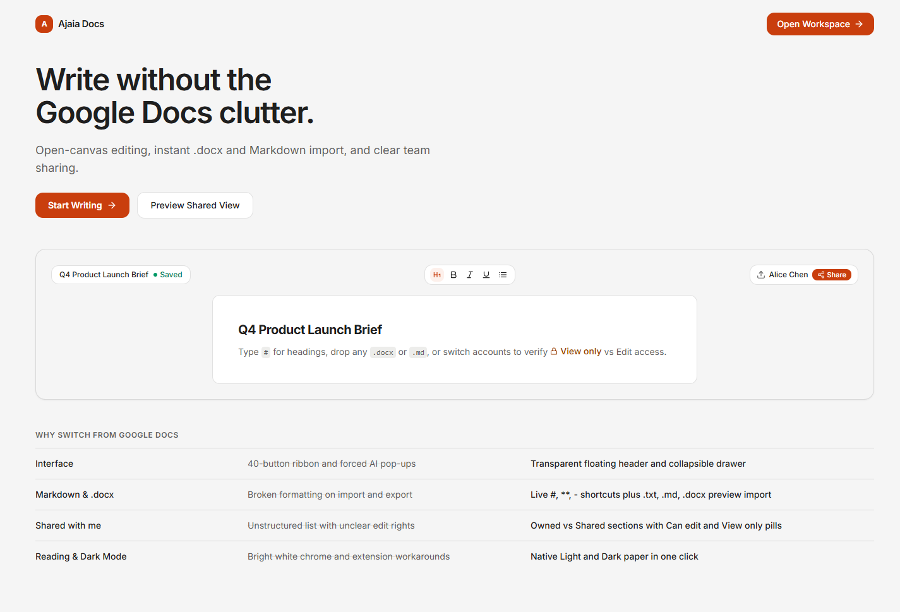
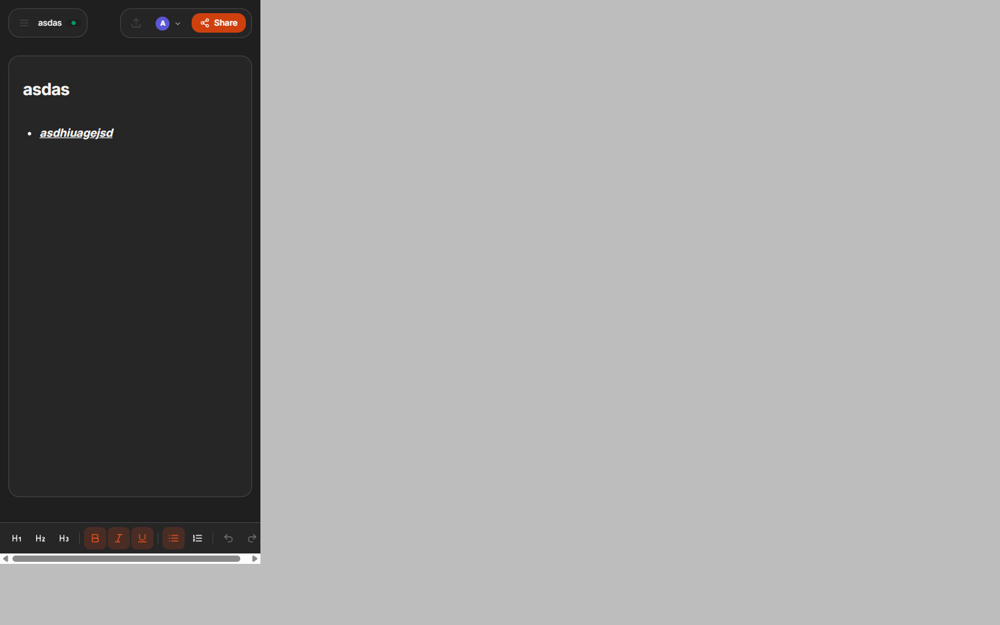

# Ajaia Docs (Sheif Docs)

A calm, self-hostable Google Docs alternative with native Markdown, `.docx` import, dark mode, and clear team sharing.

**Live Demo:** [https://docs.sheif.org](https://docs.sheif.org)




## Features
- **Open-Canvas Rich-Text Editing**: Transparent floating header, collapsible `Documents` drawer (`Ctrl/Cmd + \`), inline title rename (`Enter` jumps to body), and Tiptap editor supporting **Bold**, *Italic*, <u>Underline</u>, **H1 / H2 / H3**, **Bulleted / Numbered Lists**, **Undo / Redo**, `/` slash commands, Markdown input shortcuts (`# `, `**bold**`, `- `), and a selection bubble menu.
- **File Upload & Preview Import**: Drag and drop anywhere or click Upload. Supports **`.txt`**, **`.md`**, and **`.docx`** up to **2 MB** (strictly validated on both client and server). Shows a live parsed preview where you can edit the title and choose **Create Document** or **Append to Current**.
- **Sharing & Access Control**: Clear **Owned by me** vs **Shared with me** sections with owner attribution and `Can edit` / `View only` badges. 1-click **User Switcher** in the header (`Alice Chen`, `Bob Reyes`, `Carol Santos`) backed by an HMAC-signed `httpOnly` cookie, with server-enforced `403 Forbidden` checks on unauthorized edits, shares, and deletes.
- **Persistence & Export**: Uses **Supabase Postgres** (isolated `ajaia_docs` schema) when `DATABASE_URL` is configured, and falls back to **zero-config local SQLite** (`file:./data/ajaia-docs.db`) when `DATABASE_URL` is omitted—so reviewers can run locally with no external services. Includes 1-click `.md` and `.html` export and a native Light/Dark mode toggle.

## Supported File Types
- `.txt` (Plain text, split into paragraphs)
- `.md` (GitHub-flavored Markdown parsed to structured HTML)
- `.docx` (Word documents parsed via `mammoth`)
- **Max file size:** `2 MB` (requests exceeding 2 MB or using other extensions return `400 Bad Request`).

## Seeded Demo Accounts (1-Click Switcher)
| Name | Email | Default Workspace Role |
|---|---|---|
| Alice Chen | `alice@ajaia.dev` | Owner of *Q4 Product Launch Brief* & *Personal Scratchpad* |
| Bob Reyes | `bob@ajaia.dev` | `Can edit` on Alice's brief; Owner of *Engineering Handoff Notes* |
| Carol Santos | `carol@ajaia.dev` | `View only` on Alice's brief (locked editor + `Make a Copy` option) |

## Local Setup & Run Instructions
```bash
npm install
npm run dev
```
Open [http://localhost:3000](http://localhost:3000). No `.env` file is required for local development (SQLite auto-initializes and seeds at `./data/ajaia-docs.db`).

### Optional Production Environment Variables (`.env.local`)
See `.env.example`:
- `DATABASE_URL`: PostgreSQL connection string (e.g. Supabase Transaction Pooler; tables live in `ajaia_docs` schema).
- `SESSION_SECRET`: Secret used to HMAC-sign `ajaia_session` cookies.

## Automated Tests
```bash
npm test
```
Runs `node --experimental-strip-types --test tests/*.test.ts` against an isolated temporary SQLite database covering document CRUD/persistence, file upload validation/sanitization, session signing, and owner/edit/view access boundaries.
